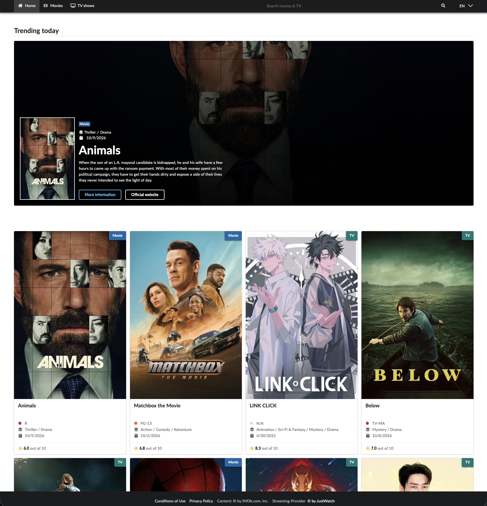

# TMDB Next.js Frontend

A Next.js frontend for browsing movies and TV shows from the TMDB API.

The application provides a media catalog with trending sections, paginated lists, detail pages, localized typeahead search, and fallback mechanisms for missing data.



## Project Goal

This project serves as a frontend for a TMDB-based media catalog.

Its focus is on:

- clear presentation of movies and TV shows
- reusable React components
- robust handling of incomplete API data
- clean separation of UI, utility logic, and service layers
- a maintainable and testable architecture
- accessibility compliance (WCAG 2.2 AA)

## AI-assisted development and technical debt

This project uses AI-assisted development within a clearly defined engineering workflow. `AGENTS.md` is the central entry point for AI coding assistants and directs them to task-specific skills, project constraints, testing rules, security requirements, and validation commands.

The `.agent/skills/` directory provides focused guidance for TMDB development, testing, accessibility, security, and AI collaboration. Project documentation in `docs/` supplements this context with testing strategy, security tests, and accessibility audit guidance.

I am aware that AI-generated code can introduce hidden technical debt, including duplicated logic, architectural inconsistencies, unnecessary dependencies, and security issues that may not be visible in passing tests. Therefore, AI is treated as an accelerator, not as a replacement for architectural decisions, quality assurance, or critical code review.

The project mitigates these risks through a dedicated TMDB service layer, server-side API integration, Zod-based runtime validation, automated Vitest and Cypress tests, accessibility checks, security tests, and review-oriented Git workflows.

## Features

- Homepage with trending movies and TV shows
- Separate overview pages for movies and TV shows
- Detail pages with images, metadata, cast, and production information
- Typeahead search for movies and TV shows
- Localized interface
- Language switching through the global header
- Locale propagation through internal navigation and server-side data requests
- Restoration of the last visited page in paginated lists
- Duplicate removal when loading additional data
- Shared error dialog for API and loading errors
- Reusable components for cards, search, pagination, and error states

## Internationalization

Translation catalogs for UI text and rating formats are stored in:

- `lib/i18n/ui.json`
- `lib/i18n/ratings.json`

Locale logic is located in:

- `lib/i18n/config.js` for locale configuration (default and supported locales)
- `lib/i18n/helpers.js` for text lookup and fallbacks
- `lib/i18n/resolver.js` for resolving the active locale per request

The current route is preserved when the language changes.

## Streaming Data

The displayed streaming providers and watch links are supplied through the TMDB API. The streaming data comes from JustWatch and is labeled "Provided by JustWatch" on movie and TV show detail pages.

## TMDB Integration

The application integrates the third-party [TMDB REST API](https://developer.themoviedb.org/docs/getting-started) on the server.

TMDB requests are handled by the dedicated service layer in `lib/services/tmdb-api.js`. Server Components and server-side data requests use this client to fetch movie, TV show, search, and streaming-provider data. The TMDB API key is read from server-side environment variables and is never exposed to the browser.

This is a server-side third-party REST API integration rather than a direct browser-to-TMDB integration. Next.js acts as the backend layer for the frontend: it performs TMDB requests, validates external responses with Zod, applies locale-specific parameters, and passes prepared data to the React UI.

### Data flow

```text
Browser / React UI
        |
        v
Next.js server (Server Components / server-side data requests)
        |
        v
TMDB REST API
        |
        v
Next.js server
        |
        v
Browser / React UI
```

### Characteristics

- **Server-side REST API integration:** TMDB is consumed over HTTPS using its REST endpoints and JSON responses.
- **Third-party API integration:** TMDB is an external service and is not part of the application backend.
- **Dedicated service layer:** TMDB-specific request logic is centralized in `lib/services/tmdb-api.js`.
- **Backend-for-Frontend (BFF) characteristics:** Next.js prepares and supplies external data specifically for this web frontend.
- **Secure credential handling:** `TMDB_API_KEY` remains on the server and is excluded from client bundles.
- **Runtime validation:** External TMDB responses are validated with Zod schemas in `lib/schemas/`.

## Tech Stack

- Next.js 16 (App Router)
- React 19
- JavaScript (no TypeScript)
- Fomantic UI CSS
- Sass
- Zod for runtime validation
- Vitest for unit, component, and integration testing
- Cypress for browser-based acceptance (end-to-end), accessibility, and security testing
- Prettier and ESLint for formatting and code quality
- Husky and lint-staged for pre-commit validation

## Type Safety Strategy

Type safety is achieved through two complementary tools:

- **JSDoc** — for documenting function signatures, parameters, and return types directly in the source code. JSDoc comments provide IDE type hints and serve as inline documentation. Use `@param`, `@returns`, and `@typedef` for important or non-obvious functions.
- **Zod** — for runtime validation of external data (API responses, form inputs). Zod schemas live in `lib/schemas/` and are used in API routes and wherever data from external sources enters the application.

### When to use which

| Use case                | Tool                        |
| ----------------------- | --------------------------- |
| Component props         | JSDoc `@param`              |
| Function signatures     | JSDoc `@param` / `@returns` |
| Shared type definitions | JSDoc `@typedef`            |
| API response validation | Zod                         |
| Form input validation   | Zod                         |
| External data ingestion | Zod                         |

## Project Structure

```
app/              # Next.js App Router (routes)
components/       # React components
lib/
  services/       # TMDB API client (tmdb-api.js)
  i18n/           # Translations and locale helpers
  stores/         # React Context stores
  utils/          # Utility functions
  schemas/        # Zod validation schemas + JSDoc typedefs
styles/           # Sass styles (Fomantic UI)
docs/             # Project documentation
vitest/           # Vitest tests (unit, component, integration), fixtures, mocks, setup
cypress/          # Cypress acceptance, accessibility, and security tests, page objects, fixtures, support
```

## Environment Variables

Copy `.env.example` to `.env.local` and fill in your values:

```bash
cp .env.example .env.local
```

| Variable                     | Description                   |
| ---------------------------- | ----------------------------- |
| `TMDB_API_KEY`               | API key for the TMDB API      |
| `NEXT_PUBLIC_DEFAULT_LOCALE` | Default locale (e.g. `en-US`) |

## TMDB API Key

You can create your own API key in your TMDB account:

- [TMDB Getting Started](https://developer.themoviedb.org/docs/getting-started)
- [TMDB API Settings](https://www.themoviedb.org/settings/api)

The key is only used on the server. Do not add it to client code or to the `env` option in `next.config.js`, because that would put it into the browser bundles.

## Requirements

- Node.js `v26.6.0`
- npm `11.x`

## Installation and Startup

```bash
npm install
npm run dev
```

`npm install` also initializes Husky through the `prepare` script.

## Testing

Tests are separated by runner and purpose:

- [Vitest](https://vitest.dev/) unit tests: `vitest/unit/`
- Vitest component tests (browser mode with Playwright/Chromium): `vitest/component/`
- Vitest integration tests (jsdom): `vitest/integration/`
- Cypress browser-based acceptance tests: `cypress/e2e/` for end-to-end flows and shared UI behavior, `cypress/accessibility/` for accessibility checks
- Cypress security tests: `cypress/e2e/security/` for manipulated input, security headers, redirects, and API key exposure

Cypress Page Objects live in `cypress/POM/`; Cypress-specific fixtures and support files live in `cypress/fixtures/` and `cypress/support/`. Shared domain fixtures for Vitest live in `vitest/fixtures/`.

```bash
npm test                    # All Vitest projects, single run
npm run test:unit           # Vitest unit tests only
npm run test:component      # Vitest component tests (browser mode)
npm run test:integration    # Vitest integration tests only
npm run test:coverage       # All Vitest projects with combined coverage
```

Vitest and coverage do not require a separately running Next.js server.

### Complete automated validation

```bash
npm run validate:all
```

This runs the Vitest validation workflow, a production build and all
configured Cypress specs, including security and accessibility, followed by a
production dependency audit with `npm audit --omit=dev --audit-level=high`.
The E2E runner starts and stops its production server automatically. A failing
command prevents later commands from starting.

Stop any server on port 3000 before the run. Live-data scenarios require a
valid server-side `TMDB_API_KEY`. Chrome and the Playwright Chromium browser
used by component tests must be available. Manual accessibility checks remain separate.

The dependency audit checks production dependencies only and fails on high or
critical advisories. It does not modify the lockfile or installed packages.

### End-to-end tests

These commands each build the app once, start the production server, run
Cypress, and stop the server afterwards:

```bash
npm run test:e2e
npm run test:e2e:security
npm run test:e2e:a11y
npm run test:e2e:open
```

- `test:e2e`: all configured Cypress specs, including security and accessibility.
- `test:e2e:security`: security specs only.
- `test:e2e:a11y`: accessibility specs only.
- `test:e2e:open`: interactive Cypress; the server remains running until Cypress exits.

The runner checks port 3000 before and after building and rejects occupied
ports rather than reusing a development server or killing another process.
Do not start a separate server or override baseUrl during managed tests.

To run one spec with the managed production server:

```bash
npm run test:e2e -- --spec "cypress/e2e/security/routing.cy.js"
```

When creating an IDE run configuration, select the npm script and leave the Arguments field empty unless additional arguments are intentionally required.

The accessibility tests for lists and detail pages load real TMDB data on the server, so the app needs a valid `TMDB_API_KEY`. Isolated component accessibility behavior, including TypeHeadSearch and TabGroupe keyboard and ARIA states, is covered in Vitest browser mode. Passing automated checks alone does not establish full WCAG conformance; use the [manual audit checklist](docs/testing/accessibility-audit-checklist.md) as well.

See [docs/testing.md](docs/testing.md) for the testing strategy, commands, and conventions.

## Validation Workflow

Use the validation commands to run the existing test suites as regression checks:

```bash
npm run validate:all
npm run validate
npm run validate:fast
```

- `validate:all`: complete automated validation, including lint, format, Vitest coverage, production build, all Cypress specs with managed server startup and shutdown, and a production dependency audit.
- `validate`: lint, formatting check, unit tests, component tests, integration tests, and combined Vitest coverage; no production build, Cypress, or dependency audit.
- `validate:fast`: ESLint, Prettier check, and Vitest unit tests.

`validate` and `validate:all` use `scripts/run-checks.mjs` for friendly progress output. They run the same underlying npm commands and retain fail-fast behavior.

Run one focused check through the existing validation commands:

```bash
npm run validate -- lint
npm run validate -- format
npm run validate -- unit
npm run validate -- component
npm run validate -- integration
npm run validate -- coverage

npm run validate:all -- e2e
npm run validate:all -- security
npm run validate:all -- a11y
npm run validate:all -- audit
```

For example, `npm run validate -- component` runs `npm run test:component`.

Run `npm run validate:fast` for quick feedback before committing.
Run `npm run validate:all` for the complete automated check before final review.
For Vitest-only validation before pushing or opening a pull request, use
`npm run validate`; use the relevant managed browser command when browser
behavior is affected. `npm run build` remains available as a standalone build check.

`bash scripts/validate.sh` is an alternative check sequence that includes a production build but no explicit coverage run; it is not equivalent to `npm run validate` or `npm run validate:all`.

## Pre-Commit Hook

Husky runs the following command from `.husky/pre-commit` before every commit:

```sh
npx lint-staged && npm run validate:fast
```

1. `lint-staged` runs `prettier --write` on staged JavaScript, JSX, Sass, CSS, Markdown, and JSON files using the configuration in `package.json`.
2. Only if lint-staged succeeds, `validate:fast` runs ESLint, the project-wide Prettier check, and the Vitest unit tests.
3. A failure in either command prevents the commit.

Formatting applies to matching staged files, whereas `validate:fast` checks the project, not just the staged changes. Running `npm run validate:fast` directly does not run lint-staged or automatically format files.

The hook intentionally excludes component, integration, Cypress, security, accessibility, and dependency-audit checks because they are slower, require application startup, or depend on external advisory data. Run `npm run validate:all` for complete automated validation before final review.

## Code Quality

Linting and formatting run separately from the tests:

```bash
npm run lint            # ESLint, fails on any warning (--max-warnings=0)
npm run format          # Prettier, rewrites files
npm run format:check    # Prettier, check only
```

If a lint rule has to be suppressed, use a targeted `eslint-disable-next-line` comment with a short reason, for example for the plain `` in the typeahead thumbnails and in the `next/image` test mock.

## Production Build

```bash
npm run build
npm run start
```

## Documentation

- [Testing Strategy](docs/testing.md) — testing strategy, commands, and test-level guidance
- [Security Tests](docs/testing/security-tests.md) — security tests, test plan, and run instructions
- [Accessibility Test Plan](cypress/accessibility/accessibility-testplan.md) — automated accessibility coverage, data notes, and run instructions
- [Manual Accessibility Audit Checklist](docs/testing/accessibility-audit-checklist.md) — manual checks and audit records
